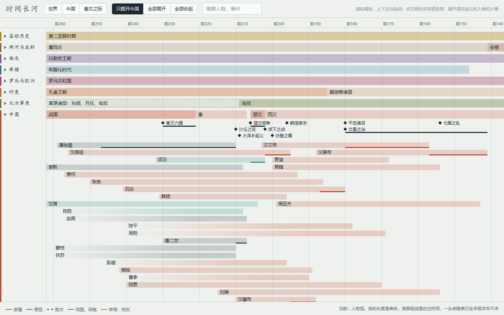

# History · 历史长河

一个直观展示各国历史的网站：横向时间轴 + 文明泳道，可像地图一样缩放；人物是节点，关系是连线。

- 先做中国史（朝代主线 → 人物 → 事件 → 人物关系）
- 古代史从圣经历史起笔，并列两河、埃及、希腊、罗马等文明
- 近代覆盖欧美、日本、韩国、东南亚等
- 中文起步，结构数据与文字分离，预留多语言

当前阶段：**P2 样板朝代**——展现形式已定稿为“时间长河”，正式站点已搭好，秦汉之际的内容正在逐批对照史料查证。

## 文档

- [项目计划](docs/plan.md) —— 展现形式、数据模型、技术方案、路线图、待确认事项

## 信息来源

网站上的人物、事件、年份、关系，来源分两层。**目前大部分内容还在第一层。**

**第一层：AI 凭记忆写的草稿（未核对）。** 示例阶段的全部内容都是 AI 凭训练记忆写出的，没有逐条对照史料，不能当作可靠内容。

**第二层：对照史料查证后的文字（进行中）。** 按 [内容撰写与查证规范](docs/content-guide.md) 分批查证：每一句陈述都要能在该条目的 `sources` 里找到依据，查不到的不写，有争议的写明有争议。各批依据的主要史料：

| 范围 | 主要史料 | 查阅渠道 |
|---|---|---|
| 秦、楚汉、西汉前期 | 《史记》《汉书》相关本纪、世家、列传 | ctext.org（中国哲学书电子化计划） |
| 北方草原、朝鲜半岛、百越 | 《史记》匈奴、朝鲜、南越各传，《汉书》，《三国志》裴注引《魏略》，《水经注》引《交州外域记》，《大越史记全书》 | ctext.org |
| 罗马、迦太基、希腊 | 波利比乌斯《历史》、李维《罗马史》、普鲁塔克《名人传》、阿庇安《罗马史》、第欧根尼·拉尔修《名哲言行录》 | Perseus、LacusCurtius、Livius.org |
| 托勒密埃及、塞琉古、安息 | 波利比乌斯《历史》、李维《罗马史》、阿庇安《叙利亚战争》、查士丁《腓力史摘要》、斯特拉波《地理学》、罗塞塔石碑铭文 | Livius.org、Encyclopaedia Iranica |
| 第二圣殿时期的犹太、印度 | 《马加比一书》《马加比二书》、约瑟夫斯《犹太古史》、《阿里斯提亚书信》、阿育王摩崖诏令、《岛史》《大史》、《弥兰陀王问经》 | Jewish Encyclopedia、Britannica |

- 中英文维基百科、Wikidata 只用来核对年份和编号；正文的事实以原始史料为准。
- 网站上每个人物、事件的最下面都有“信息出处”一栏（侧栏卡片、全屏、独立页面都有）：
  - 查证过的条目，逐条列出所依据的史料，网络资源带可以点开的链接；
  - 还没查证的条目，照实注明“由 AI 模型 Claude Fable 5.2 凭训练记忆写成，尚未对照史料查证”。
- 出处写在条目自己的文字文件里（`locales/zh-CN/person|event/<id>.yaml` 的 `sources`）。
- 圣经历史一栏以圣经及《马加比书》等典籍的记载为据，与外部史料有出入的地方如实说明。

**核对状态。** 查证由 AI 联网阅读史料后完成，仍可能读错原文或换算错年份。每个条目带 `reviewed` 标记，只有人工逐句核对过出处才改为 `true`；在此之前，网站上注明“尚未经人工核对”。运行 `npm run validate` 可以看到还有多少条目没有出处、没有核对。

计划使用的数据库（Wikidata、CBDB、CHGIS、Pleiades）及其授权条款，见 [项目计划](docs/plan.md) 第 4.5 节。

## 运行与发布

需要 Node.js。第一次先运行 `npm install`。

- `npm run dev`：本机预览，改了数据或代码会自动刷新。
- `npm run validate`：检查数据（年份先后、引用的人物和地点是否存在等），并列出还缺什么。
- `npm run build`：先校验，再生成 `dist/`。整个 `dist/` 目录是纯静态文件，放到任何能放静态文件的主机上即可。

目录：`data/` 结构数据，`locales/zh-CN/` 中文文字，`src/` 站点代码，`scripts/` 校验脚本。

## 展现形式示例

`prototypes/` 里是定稿前用来讨论展现形式的“时间长河”示例，有桌面版和手机版。现在已按它开始正式开发（正式站点的代码在 `src/`）。当初一并做过的方案 B“历史长卷”和方案 C“人物关系网”已放弃，文件已删除，需要时可在 Git 历史里找回。

示例数据：秦汉之际及同一时期的其他文明和民族，11 条泳道、69 个人物、46 件大事、95 条关系。

### 时间长河

横轴是时间，每个文明一条泳道。像地图一样缩放：远看是各文明的时代，放大到朝代后，人物的生卒条和事件自己浮出来。选中一个人，他和别人的关系线才亮起。

**桌面版**（放大到秦汉之际，展开中国泳道）：

**手机版**（罗马与欧洲泳道，选中汉尼拔）：

**可以试试：**

- 点左上角的“世界”，再用滚轮一路放大到秦汉。
- 鼠标在图上移动，左栏会显示这一年每个文明处在哪个时期。
- 点任意一个文明的名称或色带，展开或收起它的人物和大事；或者用顶上的“全部展开”。
- 点顶上的“搜索人物、事件”，分两类查找；选中后在卡片里点“展开全屏”看年表和同时代的人。
- 点“汉尼拔”，希腊和塞琉古泳道里与他相关的人会浮出来并连上线。
- 上下左右拖动画面；内容多了以后一屏放不下。
- 手机版点顶上的文明名称切换；虚线框是其他文明里相关的人。

**长处：**

- 谁先谁后、谁和谁同时在世，不用读数字就能看出来。
- 多个文明天然并排，同一年各地在发生什么一目了然。
- 从六千年到一个人的一生，是同一张图，不用换页面。

**短处：**

- 第一次用需要学会缩放。
- 文明一多，人物层一屏放不下，要靠“收起”和上下拖动来管。
- 手机上要改成竖排，一次只能看一个文明。
- 制作工作量大。

### 怎么打开

不需要安装任何东西：

- 直接双击 [prototypes/index.html](prototypes/index.html) 用浏览器打开；
- 或者在本目录运行 `python -m http.server 4173 --directory prototypes`，然后访问 <http://localhost:4173>。

示例数据只为演示形式：年代取通行说法，还没有逐条核对出处；并立政权、世界各文明的分期都做了简化。生年不详的人物画成一头渐隐的条。带虚线边框的时期是传统说法，斜线底纹的时期只排先后、不标年份。
