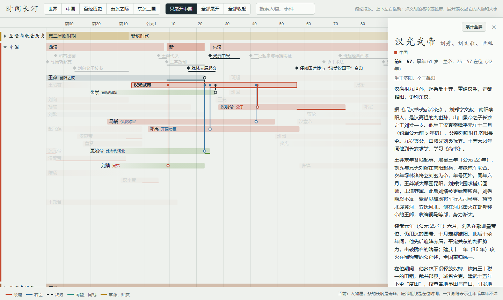
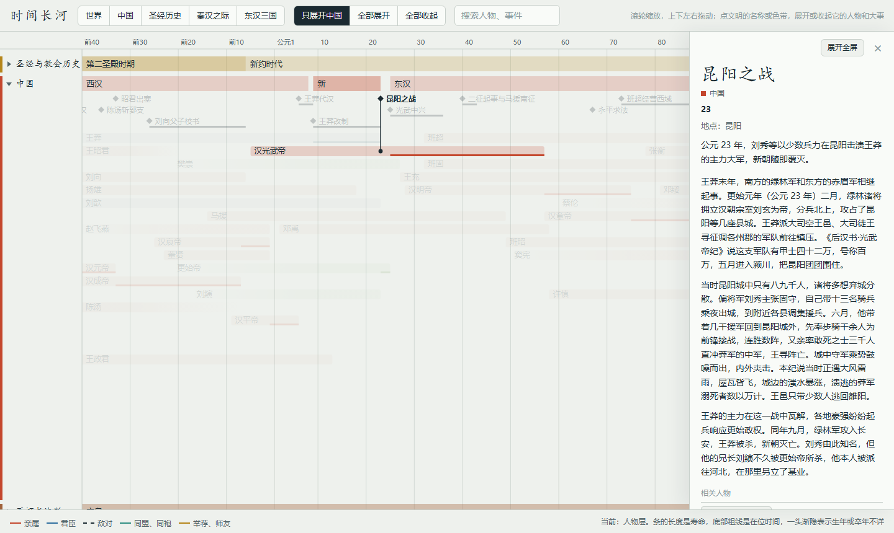
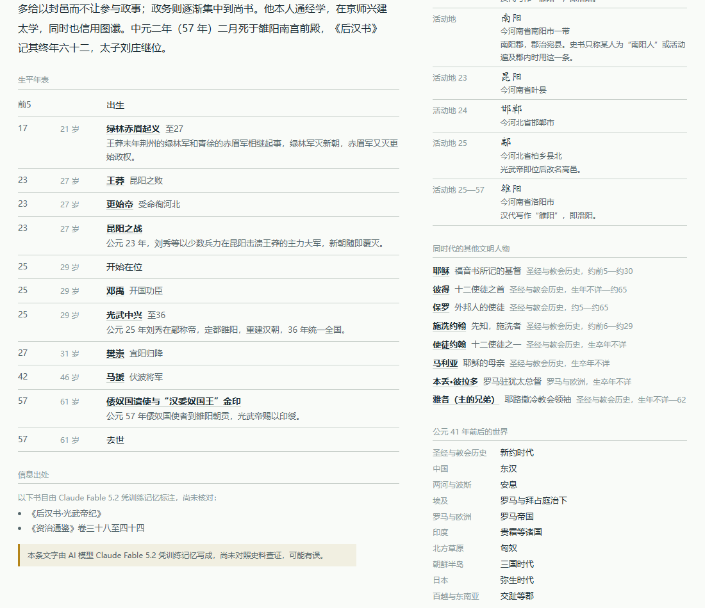
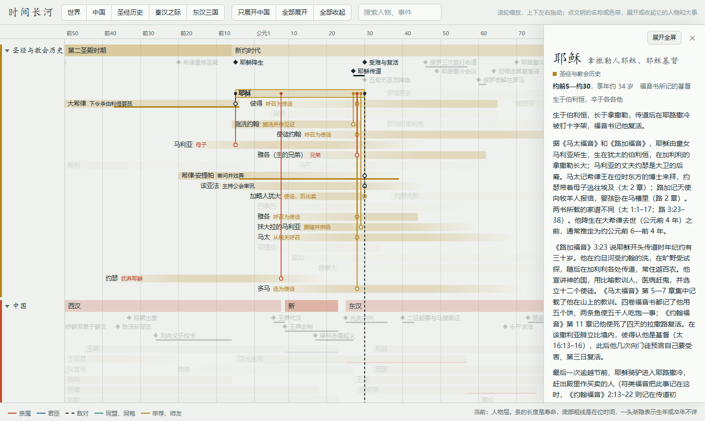
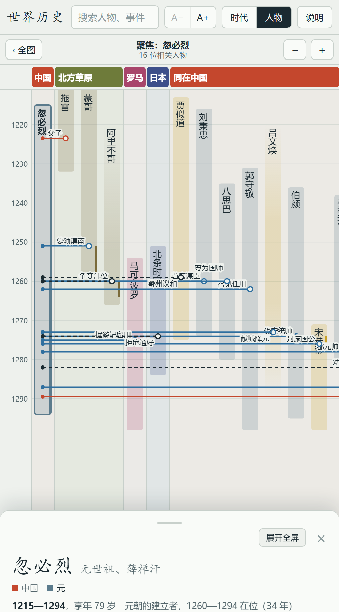
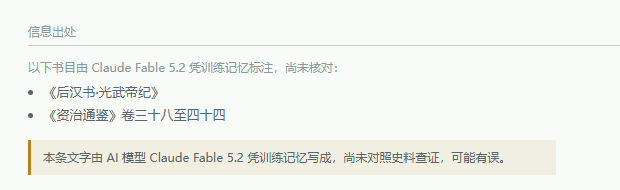
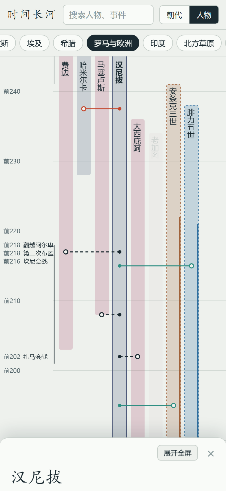

# History · 历史长河

一个直观展示各国历史的网站：横向时间轴 + 文明泳道，可像地图一样缩放；人物是节点，关系是连线。

- 先做中国史（朝代主线 → 人物 → 事件 → 人物关系）
- 古代史从圣经历史起笔，并列两河、埃及、希腊、罗马等文明
- 近代覆盖欧美、日本、韩国、东南亚等
- 中文起步，结构数据与文字分离，预留多语言

当前阶段：**P2 样板朝代**——展现形式已定稿为“时间长河”，正式站点已搭好，秦汉之际的内容正在逐批对照史料查证。

目前收录：11 条文明泳道、397 位人物、190 件大事、545 条人物关系、439 处地点（2026 年 11 月统计，运行 `npm run validate` 可看到最新数字）。

## 功能一览：以公元一世纪为例

下面用公元一世纪前后——王莽篡汉、光武中兴的年代——演示网站的各项功能。截图都取自正式站点。

### 1. 时间长河：同一年，各地在发生什么

横轴是时间，每个文明一条泳道。最上面一层是朝代或时代的色带，展开后下面浮出这一时期的大事（◆）和人物（横条，长度就是寿命，底部的粗线是在位时间）。滚轮缩放，从六千年的全貌一路放大到一个人的一生；拖动画面左右上下移动。

左上角的“世界”“中国”“圣经历史”“秦汉之际”“东汉三国”是常用视角，一点就到；“只展开中国”“全部展开”“全部收起”控制哪些泳道展开。

### 2. 人物介绍与人物关系

点一个人物，右侧弹出人物卡片：姓名、别名、所属文明、生卒年与享年、在位时间、生地与卒地，以及按撰写规范写成的详细生平。

同时，时间轴上和他有关系的人亮起来，用竖线连上；线的颜色表示关系种类（底部图例：亲属、君臣、敌对、同盟同袍、举荐师友），线旁注明具体关系。下图选中汉光武帝刘秀：兄长刘縯、儿子汉明帝、部将马援和邓禹、在昆阳被他击败的王莽、曾派他去河北的更始帝、归降的赤眉首领樊崇，一目了然。



### 3. 事件介绍

点一个事件（◆），时间轴移到它发生的那一年，卡片里是事件的年份、地点、详细经过和相关人物。下图是公元 23 年的昆阳之战：



### 4. 独立页面：生平年表、地点、同时代的人

卡片上点“展开全屏”，或者直接打开 `/zh/person/<人物>/`，是这个人物的独立页面。正文之外还有：

- **生平年表**：他一生经历的大事，带当时的年龄；
- **关系**：按种类分组列出相关人物；
- **地点**：一生到过的关键地方及在那里做了什么（为以后的地图功能做准备）；
- **同时代的其他文明人物**：同一时期别处有谁在世；
- **那一年的世界**：他在位或某一年时，其他文明各处在什么时期。



每个页面都有固定链接，地址栏里的 `#person/liu-xiu`、`#event/kunyang` 可以直接发给别人。

### 5. 中外对照：光武帝与耶稣是同一代人

把多个文明并排放，最大的好处是能看出平常不会联系在一起的事。比如人人都知道的耶稣：他约生于公元前 5 年，约公元 30 年在耶路撒冷受难——而汉光武帝刘秀恰好也生于公元前 5 年，耶稣开始传道的时候，刘秀刚在洛阳当上皇帝不久。

下图选中耶稣：上面是圣经与教会历史泳道，耶稣与马利亚、约瑟、施洗约翰、彼得、大希律、加略人犹大等人的关系连线；下面紧接着就是同时期的中国——西汉末、王莽的新朝、东汉初，“光武中兴”“绿林赤眉起义”等大事就在同一竖线上。



在人物独立页面“同时代的其他文明人物”一栏，也能看到刘秀的同时代人里有耶稣、彼得、保罗（见上一节截图右侧）。

### 6. 搜索

顶上的“搜索人物、事件”按名字或别名查找，结果分人物、事件两类，选中后直接跳到它所在的位置。

### 7. 手机版

手机上改成竖排：时间从上往下走，顶上点文明名称切换泳道，也可以左右滑动换到相邻的文明，停在同一年；一次看一个文明的一个朝代；点人物，卡片从下方升起。虚线框是其他文明里的相关人物。



### 8. 信息出处：每一条都写明从哪来

每个人物、事件卡片和独立页面的最下面都有“信息出处”一栏，分两种情况，网站上照实显示：

**已对照史料查证的条目**，逐条列出依据的史料，网络资源带可以点开的链接（下图为韩信，依据《史记》《汉书》）：


**还没查证的条目**，注明“由 AI 模型 Claude Fable 5.2 凭训练记忆写成，尚未对照史料查证”，并列出凭记忆记得的相关书目，供以后查证（下图为汉光武帝；公元一世纪的条目目前都还在这一层）：



无论哪一种，只要还没有人工逐句核对，都会注明“尚未经人工核对”。查证的原则和进度见下面的“信息来源”一节。

## 文档

- [项目计划](docs/plan.md) —— 展现形式、数据模型、技术方案、路线图、待确认事项

## 信息来源

网站上的人物、事件、年份、关系，来源分两层。**目前大部分内容还在第一层。**

**第一层：AI 凭记忆写的草稿（未核对）。** 示例阶段的全部内容都是 AI 凭训练记忆写出的，没有逐条对照史料，不能当作可靠内容。

**第二层：对照史料查证后的文字（进行中）。** 按 [内容撰写与查证规范](docs/content-guide.md) 分批查证：每一句陈述都要能在该条目的 `sources` 里找到依据，查不到的不写，有争议的写明有争议。各批依据的主要史料：

| 范围 | 主要史料 | 查阅渠道 |
|---|---|---|
| 秦、楚汉、西汉前期 | 《史记》《汉书》相关本纪、世家、列传 | ctext.org（中国哲学书电子化计划） |
| 北方草原、朝鲜半岛、百越 | 《史记》匈奴、朝鲜、南越各传，《汉书》，《三国志》裴注引《魏略》，《水经注》引《交州外域记》，《大越史记全书》 | ctext.org |
| 罗马、迦太基、希腊 | 波利比乌斯《历史》、李维《罗马史》、普鲁塔克《名人传》、阿庇安《罗马史》、第欧根尼·拉尔修《名哲言行录》 | Perseus、LacusCurtius、Livius.org |
| 托勒密埃及、塞琉古、安息 | 波利比乌斯《历史》、李维《罗马史》、阿庇安《叙利亚战争》、查士丁《腓力史摘要》、斯特拉波《地理学》、罗塞塔石碑铭文 | Livius.org、Encyclopaedia Iranica |
| 第二圣殿时期的犹太、印度 | 《马加比一书》《马加比二书》、约瑟夫斯《犹太古史》、《阿里斯提亚书信》、阿育王摩崖诏令、《岛史》《大史》、《弥兰陀王问经》 | Jewish Encyclopedia、Britannica |

- 中英文维基百科、Wikidata 只用来核对年份和编号；正文的事实以原始史料为准。
- 网站上每个人物、事件的最下面都有“信息出处”一栏（侧栏卡片、全屏、独立页面都有）：
  - 查证过的条目，逐条列出所依据的史料，网络资源带可以点开的链接；
  - 还没查证的条目，照实注明“由 AI 模型 Claude Fable 5.2 凭训练记忆写成，尚未对照史料查证”。
- 出处写在条目自己的文字文件里（`locales/zh-CN/person|event/<id>.yaml` 的 `sources`）。
- 圣经历史一栏以圣经及《马加比书》等典籍的记载为据，与外部史料有出入的地方如实说明。

**核对状态。** 查证由 AI 联网阅读史料后完成，仍可能读错原文或换算错年份。每个条目带 `reviewed` 标记，只有人工逐句核对过出处才改为 `true`；在此之前，网站上注明“尚未经人工核对”。运行 `npm run validate` 可以看到还有多少条目没有出处、没有核对。

计划使用的数据库（Wikidata、CBDB、CHGIS、Pleiades）及其授权条款，见 [项目计划](docs/plan.md) 第 4.5 节。

## 运行与发布

需要 Node.js。第一次先运行 `npm install`。

- `npm run dev`：本机预览，改了数据或代码会自动刷新。
- `npm run validate`：检查数据（年份先后、引用的人物和地点是否存在等），并列出还缺什么。
- `npm run build`：先校验，再生成 `dist/`。整个 `dist/` 目录是纯静态文件，放到任何能放静态文件的主机上即可。

目录：`data/` 结构数据，`locales/zh-CN/` 中文文字，`src/` 站点代码，`scripts/` 校验脚本，`deploy/` 服务器更新脚本。

### 更新线上版本

内容推送到 GitHub 后，登录服务器，以 root 执行：

```bash
history-update
```

它会拉取 GitHub `main` 分支最新代码、检查数据并构建，然后换上新版本，并检查网站能否打开；检查不通过会自动退回原版本。其他用法：

- `history-update list`：看服务器上保留了哪些版本、当前是哪个。
- `history-update rollback`：退回上一个版本（也可在后面写版本号，退回指定版本）。
- `history-update <提交哈希>`：发布指定的某个提交。

服务器上保留最近 5 个版本。脚本是 [deploy/update.sh](deploy/update.sh)，`/usr/local/bin/history-update` 指向服务器上代码副本里的这个文件，所以脚本本身的修改推送后，下一次更新时就自动生效。

## 展现形式示例

`prototypes/` 里是定稿前用来讨论展现形式的“时间长河”示例，有桌面版和手机版。现在已按它开始正式开发（正式站点的代码在 `src/`）。当初一并做过的方案 B“历史长卷”和方案 C“人物关系网”已放弃，文件已删除，需要时可在 Git 历史里找回。

示例数据：秦汉之际及同一时期的其他文明和民族，11 条泳道、69 个人物、46 件大事、95 条关系。

### 时间长河

横轴是时间，每个文明一条泳道。像地图一样缩放：远看是各文明的时代，放大到朝代后，人物的生卒条和事件自己浮出来。选中一个人，他和别人的关系线才亮起。

**桌面版**（放大到秦汉之际，展开中国泳道）：


**手机版**（罗马与欧洲泳道，选中汉尼拔）：


